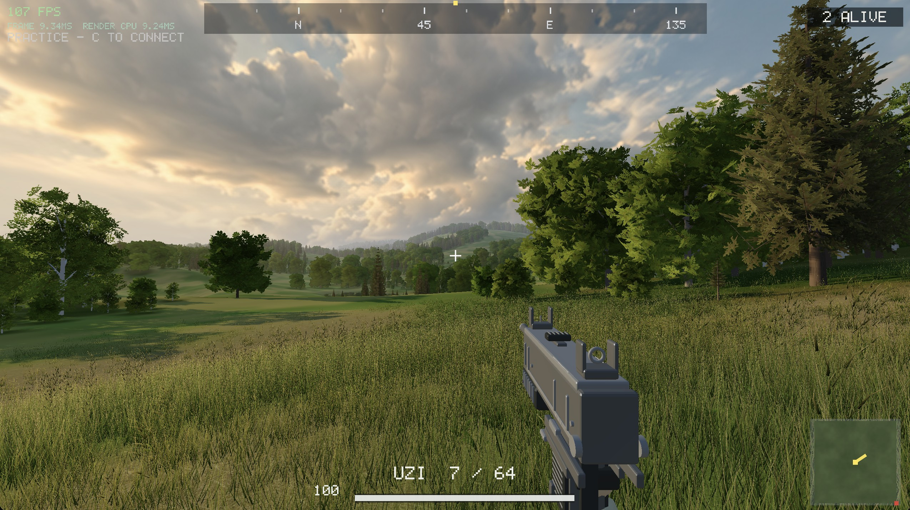

# AI PvP FPS

[](https://github.com/taavisaft/ai-pvp-fps/releases/download/v0.1.1/ai-pvp-fps-0.1.1-macos-arm64.zip)

**v0.1.1 · Apple Silicon Macs only.** Extract the ZIP and open **AI PvP FPS.app**. If macOS blocks this unnotarized build, use **System Settings → Privacy & Security → Open Anyway** after attempting to open it. [Release notes](https://github.com/taavisaft/ai-pvp-fps/releases/tag/v0.1.1).

An online first-person shooter built from scratch in **C++17**, using SDL2, OpenGL and raw UDP. No game engine.

**16-player free-for-all** across Paldiski, a 2×2 km Baltic landscape. Fight with the Uzi, Glock 19, and scoped Kar98k, projectile ballistics, and an authoritative dedicated server. Players have **100 HP** and respawn after **3 seconds**. Practice offline or join an online match.



[50-second in-game preview](docs/assets/gameplay-preview.mp4) · Silent, scripted capture from the game.

## Build and play

Requires CMake 3.20+, a C++17 compiler, SDL2 and OpenGL. On macOS: `brew install cmake sdl2`.

```sh
cmake -B build -DCMAKE_BUILD_TYPE=Release
cmake --build build --config Release
./build/game                         # test lobby
```

The game always starts in the offline test lobby: a 2×2 km training landscape
with a shooting range, meadow, pond and wooded hills. All new practice features
are available here without launch flags.

The training map also has a five-storey, 113.6 m Khrushchevka exterior at
`(0, -110)`, south of the range. Eight entrances open into an empty shell;
apartment interiors and stairs are not finished. Start at its exterior review
view with `FPS_REF=building ./build/game`. See the
[building record](docs/khrushchevka-exterior-2026-10-09.md) for assets and checks.

To play Paldiski online, start the dedicated server:

```sh
./build/server                       # Paldiski, UDP port 7777
```

In the game, press **C**, confirm the pre-filled `127.0.0.1` for a local server
(or enter another host), then select the server and connect. Disconnecting returns
you to the test lobby. These are the game's two maps: the lobby and Paldiski.
Multi-config builds place binaries under `build/Release/`.

On macOS, the game starts in desktop fullscreen at the display's native Retina
resolution. Press **Option+Return** to switch to a window, or use the settings menu.
Press **F6** in the lobby to toggle 15 roaming practice players.

## Controls

| Key | Action |
| --- | --- |
| WASD / Mouse | Move / look |
| Shift / Space | Sprint / jump |
| Left Ctrl | Crouch |
| Q / E | Lean left / right |
| Left / right click | Fire / aim down sights |
| 1 / 2 / 3 | Uzi / Glock 19 / Kar98k (8× scope on right click) |
| Scroll wheel | Cycle weapon |
| R | Reload |
| B | Cycle fire mode (Uzi: semi/burst/auto) |
| Tab (hold) | Scoreboard |
| C | Find and join a server |
| M / J | Toggle map / HUD |
| Option+Return | Toggle fullscreen |
| K | Cycle weather: Clear Day / Overcast / Golden Hour (current name shown on HUD) |
| V | Toggle third-person view |
| G | Clear bullet marks (offline) |
| H / F | Toggle hitboxes / wireframe (debug) |
| F6 | Toggle 15 roaming practice players (offline only) |
| Esc | Settings / resume (mouse and ADS sensitivity, invert Y, fullscreen, quit) |

[Roadmap](TODO.md) · [Development notes](docs/development.md) · [Contributing](AGENTS.md)

Aim settings are saved locally when you close the settings menu. Use arrow keys or click the rows; the match continues while the menu is open.

Footsteps use free CC0 grass and gravel sample banks, with distance-based local
playback. The lobby range/trail use the gravel bank; meadow uses grass. Asset
sources, rebuilding and current limits: [sounds/footsteps/README.md](sounds/footsteps/README.md).

The top-left stats show game CPU usage (100% = one CPU core) and resident RAM
in MiB, refreshed once per second, alongside FPS and frame/render timings.

### Nature preview

In the offline lobby, turn right (east) from the default spawn at `(0,136)`.
The small clearing at `x=6–70, z=92–148` contains one 10 m example of each
existing tree: full, narrow, drooping and high-crown spruce in the southern
row; ash, birch and oak in the northern row. A single berry bush and a mixed
meadow clump (green blades, straw, seed heads and broad leaves) sit by the
entrance. Four ground patches at `z=100`, west to east, show meadow, dirt,
exposed rock and forest floor. Rock is an existing terrain surface; there is
currently no standalone boulder asset. The pond and its taller shore grass
remain just north of spawn.

Use `FPS_REF=nature ./build/game` for a fixed preview view. Preview tree trunks
use the same movement and projectile collision as the surrounding forest.

The entrance now also has one juniper, hazel and flowering wild rose at
`(8,132)`, `(12,132)` and `(16,132)`. The flower row at the same X coordinates,
`z=140`, shows oxeye daisy, buttercup and fireweed. Each sample is a single
clump at its authored size, with pass-through foliage like the berry bush.
These six plants use simple 3D leaves, needles and petals, with no extra
textures. Use `FPS_REF=flowers ./build/game` for the entrance view.

A weathered two-rail timber fence encloses the nature catalogue (`x=4–70`,
`z=92–148`), with an eight-metre opening in its west side (`z=132–140`)
facing the default spawn. Walk straight east through it; no vaulting is needed.
The posts and terrain-following rails share their exact solid boxes with
movement and projectile collision. The fence includes grain, checks, lichen,
uneven caps and rusty fasteners, rendered as one static mesh per world pass.
