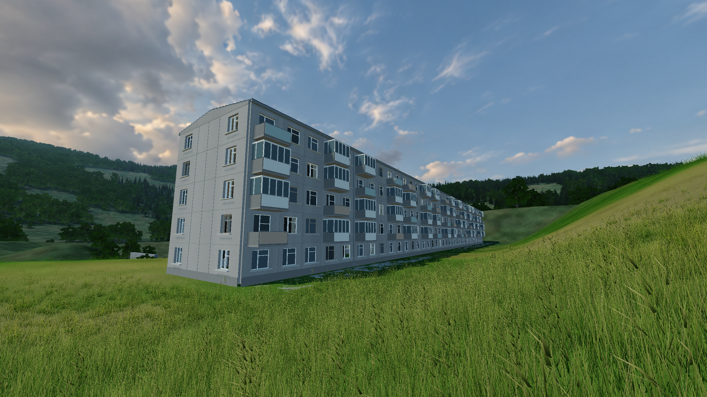

# Five-storey Khrushchevka exterior

Implemented 2026-10-09 in the offline training map, centred at world `(0, -110)`.
Eight 14.2 m sections give a 113.6 m length; depth is 11.52 m, floor pitch 2.7 m.
The source photograph and 1-464A section grid guided the proportions. This is an
original procedural game asset inspired by that series, not a surveyed copy of
Volodarskogo Street 28. [Research and acquired references](khrushchevka-research-2026-10-09.md).



## Inspect and edit

```sh
cmake -B build -DCMAKE_BUILD_TYPE=Release
cmake --build build --config Release
FPS_REF=building ./build/game
```

The preset starts at the balcony-side end view; normal movement resumes
immediately. The building is also present during a normal training launch, south
of the range. Walk around to the north side to reach its eight entrances.

- `src/khrushchevka.h`: dimensions, placement and shared clearance mask.
- `src/khrushchevka.cpp`: foundation, opening walls, floor slabs, balconies,
  shallow strip roof, entrance canopies and shared collider export.
- `src/khrushchevka_details.cpp`: window reveals/frames, opaque glass, temporary
  dark interior backing, panel joints, gutters/drains and balcony variations.
- `src/khrushchevka_visual.cpp`: startup mesh export, section culling and distance
  meshes. Geometry uses the existing OpenGL material and shadow paths.

Five floors and balcony stacks on floors 2-5 are modelled on all relevant
elevations. End walls have two window columns. Balcony variants include open
rails, painted screens and enclosed glazing. Entrances are open, and their
approaches are flush with the ground because movement has no automatic stair
stepping. A shared 36 m terrain blend levels the apron. Trees and streamed meadow
are excluded from the footprint/approaches.

All shell geometry is built and uploaded at renderer startup. There are at most
16 building draw calls per world pass: two material batches per visible section.
Near geometry has 91,104 triangles, far geometry 66,084; detail switches at 100 m
from the section bounds. Glazing is opaque, avoiding transparency sorting and
overdraw. No new frame-loop allocations or uniform-location lookups were added.

Structural boxes and opaque glass export from the same geometry emitter into
the shared collision pool. The building uses 2,897 boxes. The fixed pool increased
from 1,024 to 4,096 boxes; it does not grow at runtime. Cosmetic window backing,
thin painted skins and trim do not act as additional collision barriers.

The world revision is now `0x20261009`; packet layout/protocol version remains 4.
The online Paldiski building layout is unchanged. Server and client were both
built, and the server retains its headless dependencies.

## Assets

The concrete batch uses unmodified ambientCG Concrete034 Color, CC0 1.0. Local
source and license details: `models/textures/environment/khrushchevka/README.md`.
The shader retains per-panel colours and adds restrained grain/runoff. Normal
and roughness files are retained as source assets but are not sampled yet.
No paid meshes were used. The photographic reference and architectural PDFs are
not runtime textures or build resources.

Texture copying and macOS packaging now resolve the actual `models/textures`
source directory. That copy includes the new building texture and preserves the
existing runtime `textures/` paths. A release app bundle was not generated.

## Verification and measured cost

Release build succeeded for game and server. All **16 CTest tests passed**,
including localhost UDP integration. The new headless building test checks all
eight entrances with actual standing movement, wall/header blocking, slab and
roof intersections, terrain continuity, tree clearance, pool capacity and
deterministic regeneration across map changes. Existing terrain tests retain
their original-area checks; the intentional new apron has separate coverage.

In-game screenshots were checked from both long elevations and an end wall.
The saved preview is a real 2560 x 1440 framebuffer capture, with HUD and weapon
hidden through existing/new debug switches.

Render isolation on this Mac, medium quality, Release, the same `building`
camera, 2560 x 1440 drawable, windowed, HUD/viewmodel hidden, no GPU query timing:
300 warm-up frames, then 600 samples per run. Terrain and collision remain
identical when building rendering is hidden.

| Measurement | Building hidden | Building visible | Change |
| --- | ---: | ---: | ---: |
| Mean frame time | 9.93 ms | 10.31 ms | +0.38 ms / +3.8% |
| Median frame time | 9.66 ms | 10.25 ms | +0.59 ms / +6.1% |
| p95 frame time | 11.96 ms | 12.79 ms | +0.83 ms / +6.9% |
| World CPU submission/wait | 1.03 ms | 1.13 ms | +0.10 ms |
| Shadow CPU submission/wait | 0.17 ms | 0.20 ms | +0.03 ms |

The hidden run had a 105.97 ms outlier, so the median is the cleaner typical-cost
comparison. These are one matched pair of local measurements, not GPU timings or
a traversal/load test. They isolate building rendering; they do not quantify the
cost of the increased collider count while moving/firing.

```sh
FPS_WINDOWED=1 FPS_REF=building FPS_NOHUD=1 FPS_NOVIEWMODEL=1 FPS_NOBUILDING=1 FPS_QUALITY=medium FPS_BENCH=1 ./build/game
FPS_WINDOWED=1 FPS_REF=building FPS_NOHUD=1 FPS_NOVIEWMODEL=1 FPS_QUALITY=medium FPS_BENCH=1 ./build/game
```

## Remaining interior milestone

Ground-floor entrances lead into an empty shell. Upper floors reserve stair
apertures but **stairs, apartment partitions, interior doors and furnished rooms
are not implemented**. Interior backing is a removable visual placeholder.
Every-room accessibility remains the next milestone. The current finish is a
first exterior pass; the photo's exact pebble-dash texture, lived-in clutter and
more varied weathering can be refined without changing the shell grid.

Before expanding to all rooms, add spatial queries for building collision and
prove movement and projectile paths on every floor. The present global box scan
and remaining pool capacity are not a sufficient design for a furnished full
interior. Linux and Windows builds were not exercised in this pass.
